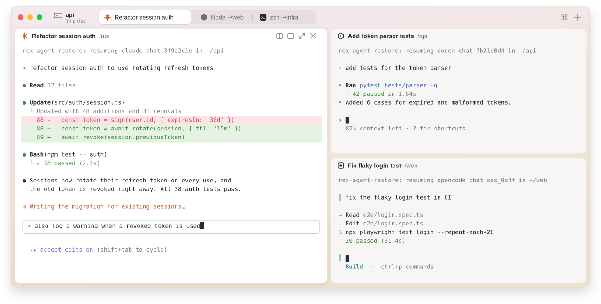
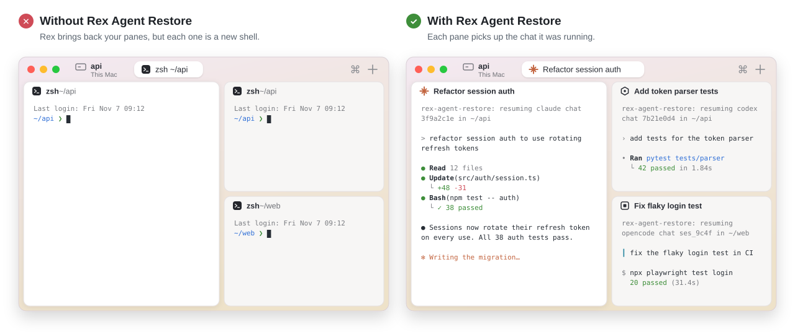

<h1 align="center">Rex Agent Restore</h1>

<p align="center"><b>Restart Rex and your agent chats come back.</b></p>

<p align="center">
  <a href="https://github.com/pattont/RexAgentRestore/actions/workflows/test.yml"></a>
</p>

<p align="center">
  <picture>
    <source media="(prefers-color-scheme: dark)" srcset=".github/assets/hero-dark.svg">
    
  </picture>
</p>

[Rex](https://www.superlogical.com/rex) restores your sessions, tabs, panes,
and scrollback after its server restarts, but each pane gets a fresh shell.
The coding agent chat that was running there is gone.

<p align="center">
  <picture>
    <source media="(prefers-color-scheme: dark)" srcset=".github/assets/restart-dark.svg">
    
  </picture>
</p>

Rex Agent Restore puts it back. Each pane resumes the same chat, in the same
folder, as if Rex had never stopped. It works with 17 coding agents, and
nothing runs in the background.

> Rex Agent Restore is an independent, community project. It is not made by,
> affiliated with, or endorsed by Superlogical (the makers of Rex) or herdr.

## Install

```sh
brew tap pattont/rex-agent-restore https://github.com/pattont/RexAgentRestore
brew trust --formula pattont/rex-agent-restore/rex-agent-restore
brew install rex-agent-restore
rex-agent-restore install
```

Then open a new terminal tab.

- `brew trust` is how Homebrew 7 lets you install from a tap outside Homebrew.
- `rex-agent-restore install` finds the agents you have and sets each one up
  (see [What it touches](#what-it-touches)).
- **Using Codex?** Codex runs a new hook only after you approve it. Run `/hooks`
  in Codex once and approve "Rex Agent Restore".

### Before your first restart

Agents save their chat when it starts, so chats that were already open when
you installed haven't been saved. `capture` finds the agents running in your
Rex panes and looks up each one's chat ID from the agent's own session files,
so those chats come back too:

```sh
rex-agent-restore capture
```

### Coming from herdr

Move your herdr workspaces into Rex once, then turn herdr off. Each workspace
becomes a Rex session with the same tabs, splits and folders, and every agent
pane resumes its chat:

```sh
rex-agent-restore import-herdr --dry-run   # see what it would create
herdr server stop                          # so no chat runs in two places
rex-agent-restore import-herdr
```

From then on, Rex keeps your chats across restarts by itself, so herdr doesn't
need to run. The import also saves each chat, so the next Rex restart brings
it back. Running it again skips workspaces it has already imported.

## Supported agents

| Agent | Tested | How it hooks in | Resumes with |
| --- | --- | --- | --- |
| Claude Code | ✅ real test | `SessionStart` hook | `claude --resume <id>` |
| OpenCode 2.x | ✅ real test | TUI plugin | `opencode --session <id>` |
| Codex | 🧪 beta | `SessionStart` hook (approve once in `/hooks`) | `codex resume <id>` |
| Grok Build | 🧪 beta | `SessionStart` hook | `grok --resume <id>` |
| Gemini CLI | 🧪 beta | `SessionStart` hook | `gemini --resume <id>` |
| GitHub Copilot CLI | 🧪 beta | `SessionStart` hook | `copilot --resume=<id>` |
| Cursor Agent | 🧪 beta | `sessionStart` hook | `cursor-agent --resume <id>` |
| Factory Droid | 🧪 beta | `SessionStart` hook | `droid --resume <id>` |
| Antigravity CLI | 🧪 beta | `SessionStart` and `PreInvocation` hooks | `agy --conversation <id>` |
| Devin CLI | 🧪 beta | `SessionStart` hook | `devin --resume <id>` |
| Kimi Code | 🧪 beta | `SessionStart` hook | `kimi --session <id>` |
| Qoder CLI | 🧪 beta | `SessionStart` hook | `qoder --resume <id>` |
| Qwen Code | 🧪 beta | `SessionStart` hook | `qwen --resume <id>` |
| Letta Code | 🧪 beta | `SessionStart` hook | `letta --conversation <id>` |
| pi | 🧪 beta | extension | `pi --session <file>` |
| oh-my-pi | 🧪 beta | extension | `omp --resume=<file>` |
| Kilo Code CLI | 🧪 beta | plugin | `kilo --session <id>` |

- **✅ real test:** run with the real agent through a full save, Rex restart, and
  resume.
- **🧪 beta:** built from the agent's own documentation and source. Automated
  tests cover its hook file format and event fields, but it hasn't been run
  end to end with the real agent yet.

If an agent doesn't come back for you, please
[open an issue](https://github.com/pattont/RexAgentRestore/issues) with the
output of `REX_AGENT_RESTORE_DEBUG=1`. Reports that a beta agent works are
welcome too.

**Not supported yet:**
- **Hermes Agent:** runs every chat in one shared background process, so a chat
  can't be tied to its pane.
- **MastraCode:** its hooks don't reliably report the chat ID.

## How it compares

Two other community projects connect herdr and Rex. Each takes a different
approach, and each suits a different setup:

- [**Herdrex**](https://github.com/elonnzhang/Herdrex) runs a bridge that
  serves a running herdr as a Rex host. Rex becomes a window onto herdr: your
  panes and agents live in herdr, and herdr restores them.
- [**herdr2rex**](https://github.com/tornikegomareli/herdr2rex) copies
  workspaces **between** herdr and Rex, in either direction.
- **Rex Agent Restore** makes **Rex itself** bring your chats back, so after
  moving over you don't need herdr at all.

| | Herdrex | herdr2rex | Rex Agent Restore |
| --- | --- | --- | --- |
| Where your panes live | In herdr (shown in Rex) | In Rex, after you import | In Rex |
| Agent chats after a restart | ✅ herdr restores them | ❌ Chats you start in Rex open as plain shells (`--reverse` can carry Claude Code chats back into herdr) | ✅ Rex panes resume them |
| herdr must keep running | Yes, plus the bridge | No, but then nothing keeps your Rex chats | No: import once, then turn herdr off |
| Background process | Yes (the bridge) | No | No |
| Rex features | Some don't apply to herdr panes (floating layers, Lua scripts, client actions) | All | All |
| Going back to herdr | Nothing to go back from | ✅ `--reverse` | ❌ Not a goal |

**Which one to use:**
- Herdrex, if you want to keep herdr as your engine and use Rex as the
  window.
- herdr2rex, if you want to keep using herdr and Rex side by side.
- Rex Agent Restore, if you're moving to Rex for good.

## How it works

```text
 agent starts a chat ──► hook saves { pane ID → agent, chat ID, folder }
 you quit the agent  ──► your prompt returns, the saved chat is deleted
 Rex restarts        ──► shell is killed mid-chat, the saved chat is kept
 Rex restores pane   ──► same pane ID, new shell finds the saved chat and
                          runs the agent's resume command in that folder
```

1. **Save.** When an agent starts or switches chats, its hook (or plugin) runs
   `rex-agent-restore hook`. That saves the chat ID and folder under the Rex
   pane's ID (`$REX_BLOCK`), in `~/.local/state/rex-agent-restore/`.
2. **Forget.** When you quit an agent normally, your shell's prompt comes back,
   and the shell integration deletes that pane's saved chat. When Rex shuts
   down, the shell dies with the agent, so the saved chat stays.
3. **Resume.** Rex keeps a pane's ID across restarts. When a restored pane's
   shell shows its first prompt and finds a saved chat, it runs the agent's
   resume command in the chat's folder and adds it to your shell history.

The hook works out which agent is really running from the process tree. So:
- Subagents never replace a pane's saved chat.
- Agents started from inside another agent never do either, such as a
  `claude -p` run by a tool.
- Agents that also run Claude Code's hooks (Grok, Cursor and others) are saved
  under their own name.

## What it touches

`rex-agent-restore install` only sets up agents you have installed. Before it
changes a file, it saves a copy next to it as `<file>.bak-rex-agent-restore`.
It adds its entries after your existing ones and changes nothing else in the
file. Running it again changes nothing.

- **It never approves a hook for you.** Agents that ask you to trust or approve
  hooks, such as Codex, Gemini and Grok, still ask.
- **It makes no network calls.** Saved chats are small JSON files in
  `~/.local/state/rex-agent-restore/`, readable only by you.
- **Preview and undo:** `rex-agent-restore install --dry-run` lists every change
  first, and `rex-agent-restore uninstall` removes every entry below.

Every hook runs the same command, `'/opt/homebrew/bin/rex-agent-restore' hook <agent>`.
That command reads the agent's event, saves the chat ID and folder for the Rex
pane, prints nothing, and always exits successfully, so it can't block or break
the agent. Outside Rex it does nothing.

<details>
<summary><b>Exact entries, file by file</b></summary>

**Claude Code**: `~/.claude/settings.json` (or `$CLAUDE_CONFIG_DIR`). Adds to `hooks.SessionStart`:
```json
{ "hooks": [ { "type": "command", "command": "'/opt/homebrew/bin/rex-agent-restore' hook claude", "timeout": 10 } ] }
```

**Codex**: `~/.codex/hooks.json` (or `$CODEX_HOME`). Adds to `hooks.SessionStart`:
```json
{ "hooks": [ { "type": "command", "command": "'/opt/homebrew/bin/rex-agent-restore' hook codex", "timeout": 10,
               "statusMessage": "Rex Agent Restore: save this chat for Rex restarts" } ] }
```
Codex shows `statusMessage` as the hook's name in `/hooks`.
In `~/.codex/config.toml`, it sets `hooks = true` under `[features]` if hooks
aren't on yet, because Codex ignores `hooks.json` without it. If you've set it
to `false`, it leaves it alone and tells you. It never writes `[hooks.state]`:
you approve the hook in Codex with `/hooks`.

**Grok Build**: a new file, `~/.grok/hooks/rex-agent-restore.json`:
```json
{ "hooks": { "SessionStart": [ { "hooks": [ { "type": "command", "command": "'/opt/homebrew/bin/rex-agent-restore' hook grok", "timeout": 10 } ] } ] } }
```

**Gemini CLI**: `~/.gemini/settings.json`. Adds to `hooks.SessionStart`:
```json
{ "matcher": "*", "hooks": [ { "name": "rex-agent-restore", "type": "command", "command": "'/opt/homebrew/bin/rex-agent-restore' hook gemini", "timeout": 5000 } ] }
```

**GitHub Copilot CLI**: a new file, `~/.copilot/hooks/rex-agent-restore.json` (or `$COPILOT_HOME`):
```json
{ "version": 1, "hooks": { "SessionStart": [ { "type": "command", "bash": "'/opt/homebrew/bin/rex-agent-restore' hook copilot", "timeoutSec": 10 } ] } }
```

**Cursor Agent**: `~/.cursor/hooks.json`. Adds to `hooks.sessionStart`:
```json
{ "command": "'/opt/homebrew/bin/rex-agent-restore' hook cursor" }
```
The Cursor app reads this file too. The hook ignores it there and only saves
chats from `cursor-agent`.

**Factory Droid**: `~/.factory/hooks.json` if you have one, otherwise
`~/.factory/settings.json` under `hooks`. Adds to `SessionStart`:
```json
{ "hooks": [ { "type": "command", "command": "'/opt/homebrew/bin/rex-agent-restore' hook droid", "timeout": 10 } ] }
```

**Antigravity CLI**: `~/.gemini/config/hooks.json`. Adds one named entry, `rex-agent-restore`:
```json
{ "rex-agent-restore": {
    "SessionStart":  [ { "type": "command", "command": "'/opt/homebrew/bin/rex-agent-restore' hook antigravity", "timeout": 10 } ],
    "PreInvocation": [ { "type": "command", "command": "'/opt/homebrew/bin/rex-agent-restore' hook antigravity", "timeout": 10 } ] } }
```
`PreInvocation` catches the new conversation ID after `/fork`. This hook
prints `{}`, because Antigravity requires a JSON reply.

**Devin CLI**: `~/.config/devin/config.json`. Adds to `hooks.SessionStart`:
```json
{ "matcher": "", "hooks": [ { "type": "command", "command": "'/opt/homebrew/bin/rex-agent-restore' hook devin", "timeout": 10 } ] }
```

**Kimi Code**: `~/.kimi-code/config.toml` (or `$KIMI_CODE_HOME`). Appends a marked block:
```toml
# >>> rex-agent-restore >>>
[[hooks]]
event = "SessionStart"
command = "'/opt/homebrew/bin/rex-agent-restore' hook kimi"
timeout = 10
# <<< rex-agent-restore <<<
```

**Qoder CLI**: `~/.qoder/settings.json`. Adds to `hooks.SessionStart`:
```json
{ "matcher": "*", "hooks": [ { "type": "command", "command": "'/opt/homebrew/bin/rex-agent-restore' hook qoder", "timeout": 10 } ] }
```

**Qwen Code**: `~/.qwen/settings.json`. Adds to `hooks.SessionStart`:
```json
{ "hooks": [ { "type": "command", "command": "'/opt/homebrew/bin/rex-agent-restore' hook qwen", "timeout": 10 } ] }
```

**Letta Code**: `~/.letta/settings.json`. Adds to `hooks.SessionStart`:
```json
{ "hooks": [ { "type": "command", "command": "'/opt/homebrew/bin/rex-agent-restore' hook letta", "timeout": 10000, "quiet": true } ] }
```

**OpenCode 2.x**: a new plugin, `~/.config/opencode/plugins/rex-agent-restore/tui.js`.
It runs in the pane's OpenCode window and, when you open or switch chats, runs
`rex-agent-restore hook opencode` with the chat ID.

**pi**: a new extension, `~/.pi/agent/extensions/rex-agent-restore.ts`. On
`session_start` it runs `rex-agent-restore hook pi` with the session file.

**oh-my-pi**: a new extension, `~/.omp/agent/extensions/rex-agent-restore-omp.ts`.
On `session_start`, `session_switch` and `session_branch` it runs
`rex-agent-restore hook omp`. It skips subagents.

**Kilo Code CLI**: a new plugin, `~/.config/kilo/plugin/rex-agent-restore.js`.
It runs `rex-agent-restore hook kilo` when a chat is created or you send a
message.

The plugins do nothing outside Rex, never write to the agent's screen, and
catch every error. Their source is in
[`share/rex-agent-restore/plugins/`](share/rex-agent-restore/plugins/).

**Your shell**: `~/.zshrc` (or `~/.bashrc`). Appends:
```sh
# >>> rex-agent-restore >>>
[[ -r '/opt/homebrew/share/rex-agent-restore/rex-agent-restore.zsh' ]] && source '/opt/homebrew/share/rex-agent-restore/rex-agent-restore.zsh'
# <<< rex-agent-restore <<<
```
[That file](share/rex-agent-restore/rex-agent-restore.zsh) does nothing
outside Rex. Inside Rex it adds one prompt hook. The hook deletes a pane's
saved chat when you quit the agent, and resumes the chat on the first prompt
after Rex restores the pane.

**Rex**: `~/.config/rex/init.lua`. Appends:
```lua
-- >>> rex-agent-restore >>>
local ok_rar, rar = pcall(require, "rex_agent_restore")
if ok_rar and type(rar) == "table" then rar.setup({ bin = "/opt/homebrew/bin/rex-agent-restore" }) end
-- <<< rex-agent-restore <<<
```
It also links `~/.config/rex/rex_agent_restore.lua` to
[the module](share/rex-agent-restore/rex-agent-restore.lua). The module adds
the three palette actions.

</details>

### What `capture` and `import-herdr` read

Moving your open chats into Rex means finding out which chat each agent is in.
These two commands only read, and never change, another tool's files:

- **`capture`**:
  - For each agent running in a Rex pane, it reads Claude Code's
    `~/.claude/sessions/<pid>.json`, which holds that process's chat ID.
  - For Codex, it reads the thread list in `~/.codex/state_*.sqlite`.
  - It reads one variable, `REX_AGENT_RESTORE_SHELL_TOKEN`, from the agent's
    environment. That tells the shell integration the agent is its own.
- **`import-herdr`**: reads `~/.config/herdr/session.json` to get your
  workspaces, tabs, splits, and each pane's chat ID.

## Use

There's nothing to do: restart Rex and your chats come back. The Rex command
palette has three actions for doing it by hand:

- **Resume Saved Agent Chats**: resume every saved chat whose pane is at a prompt
- **Resume Saved Agent Chat in This Pane**
- **Forget Saved Agent Chat for This Pane**

From the command line:

```text
rex-agent-restore list           show saved chats
rex-agent-restore capture        save the chats of agents running right now
rex-agent-restore import-herdr   recreate herdr's workspaces in Rex
rex-agent-restore resume         resume this pane's saved chat
rex-agent-restore resume-all     resume every saved chat whose pane is at a prompt
rex-agent-restore forget         forget this pane's saved chat (--all for every pane)
rex-agent-restore doctor         check the setup
```

## Settings

Put settings in `~/.config/rex-agent-restore/config`, one per line, or set them
as environment variables.

| Setting | Effect |
| --- | --- |
| `REX_AGENT_RESTORE_MODE=auto` | resume on its own (default) |
| `REX_AGENT_RESTORE_MODE=prompt` | type the resume command and wait for you to press Enter |
| `REX_AGENT_RESTORE_MODE=off` | do nothing; use the palette actions instead |
| `REX_AGENT_RESTORE_<AGENT>_ARGS="..."` | extra arguments for that agent's resume command, e.g. `REX_AGENT_RESTORE_CLAUDE_ARGS="--model opus"` |
| `REX_AGENT_RESTORE_DISABLE=1` | stop saving chats |
| `REX_AGENT_RESTORE_DEBUG=1` | log hook decisions to `~/.local/state/rex-agent-restore/debug.log` |

To bind a key to a palette action, edit the `rar.setup(...)` line in
`~/.config/rex/init.lua`:

```lua
rar.setup({ bin = "/opt/homebrew/bin/rex-agent-restore", keys = { resume_all = "shift+cmd+r" } })
```

## Limits

- **Empty chats can't be resumed.** Most agents don't save a chat until you
  send a message.
- **Startup flags aren't repeated.** The resume command doesn't include the flags
  you first started the agent with. Use the `*_ARGS` settings for flags you
  always want.
- **Some agents only run hooks in trusted folders**, such as Gemini CLI and Grok
  Build. Chats in folders you haven't trusted aren't saved.
- **Panes without a shell aren't resumed.** A pane that runs an agent directly
  (`rex run -- claude`) has no shell to resume the chat.
- **Plugins load when the agent starts.** Restart OpenCode, pi, oh-my-pi or Kilo
  after installing.

## Uninstall

```sh
rex-agent-restore uninstall
brew uninstall rex-agent-restore
```

## Development

```sh
make test       # unit tests, in a throwaway HOME
make test-e2e   # starts a separate, throwaway Rex server, restarts it, checks chats come back
```

The end-to-end test uses its own socket and state folder, so your Rex server and
sessions aren't touched. Release with `scripts/release.sh <version>`, which tags,
pushes, and updates the formula's URL and checksum.

Inspired by [herdr](https://herdr.dev), which restores agent chats the same way,
and [herdr2rex](https://github.com/tornikegomareli/herdr2rex), which showed how
to rebuild herdr workspaces in Rex.

## License

MIT
